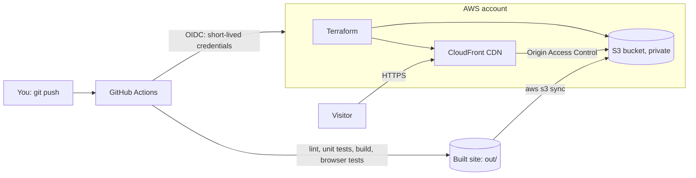

# Mohammad Afsharnejad — Portfolio

A terminal-style personal portfolio website with an interactive command line (`help`, `projects`, `skills`, `contact`…).
It is a static Next.js site hosted on **AWS S3 + CloudFront**. **Terraform** creates the infrastructure, and **GitHub Actions** tests and deploys it on every push.

**Live:** _add the CloudFront URL here after the first deploy_

## What this project proves

From the course _AI Engineer Production Track: Deploy LLMs & Agents at Scale_ (weeks 1–2):

| Concept                              | Where it is in this repo                                                      |
| ------------------------------------ | ----------------------------------------------------------------------------- |
| Next.js front end, built for prod    | `src/app`, `src/components`, `next.config.ts` (static export)                 |
| S3 + CloudFront hosting              | `infra/modules/static-site/main.tf`                                           |
| Private bucket, CloudFront-only read | Origin Access Control + bucket policy in `main.tf`                            |
| Infrastructure as Code (Terraform)   | `infra/modules`, `infra/envs/dev`, `infra/envs/prod`                          |
| Separate dev and prod environments   | `infra/envs/*`, GitHub environments `dev` and `prod`                          |
| CI/CD with GitHub Actions            | `.github/workflows/pipeline.yml`, `deploy-env.yml`, `destroy.yml`             |
| Secure deploys with no stored keys   | GitHub OIDC role in `infra/bootstrap/bootstrap.yaml`                          |
| IAM least privilege                  | Deploy role can only touch `portfolio-website-*` buckets and CloudFront       |
| Cost control                         | Monthly budget alert in `bootstrap.yaml`, cheapest CloudFront price class     |
| Testing                              | Unit tests (`tests/unit`, Vitest) and browser tests (`tests/e2e`, Playwright) |

## Architecture



Push to `main` → tests → deploy to **dev** → you click **Approve** → deploy to **prod**.

## Run it on your PC (Windows)

1. Install Node.js 22 LTS (once): `winget install OpenJS.NodeJS.LTS`, then open a new terminal.
2. In this folder:

```powershell
npm install
npm run dev
```

3. Open http://localhost:3000. Edits show up instantly.

**Change the content:** everything the site says is in `src/content/profile.ts`.
To add a project, see [docs/ADD_A_PROJECT.md](docs/ADD_A_PROJECT.md).

## Checks

```powershell
npm run lint        # TypeScript + formatting
npm test            # unit tests
npm run build       # static site → out/
npx playwright install chromium   # once, for browser tests
npm run test:e2e    # browser tests (desktop + phone)
npm run check       # all of the above
npm start           # preview the built site at http://localhost:3000
```

## Deploy to AWS

One-time setup takes about 10 minutes: **[docs/SETUP_AWS.md](docs/SETUP_AWS.md)**.
After that, every push to `main` deploys automatically.

## Cost

Designed to cost **$0/month** at portfolio traffic:

- CloudFront's always-free tier covers 1 TB of transfer and 10M requests a month. S3 storage for a ~2 MB site costs a tiny fraction of a cent.
- GitHub Actions is free on a public repo.
- A budget alert emails you if spending ever reaches 80% of 1 USD.

## Tear down

GitHub → **Actions** → **Destroy environment** → pick `dev` or `prod` → type `DESTROY`.
To remove everything, also delete the CloudFormation stack `portfolio-website-bootstrap` (and empty its state bucket first).

## Resume bullet

> Built and deployed a terminal-style portfolio site (Next.js) on AWS S3 + CloudFront with Terraform IaC, separate dev/prod environments, and a GitHub Actions CI/CD pipeline using OIDC (no stored keys), unit + browser tests and a cost budget alert.
